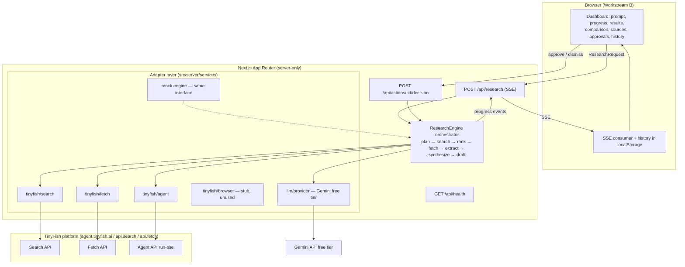

# Software Architecture

## Goals

Simplest architecture that can grow without rewrites: one Next.js app, one orchestrating API
route, four TinyFish adapters behind one interface, one LLM provider interface, no database.

## System diagram



## Request lifecycle (P0, standard mode)

1. `POST /api/research` with `ResearchRequest` (zod-validated).
2. **Plan** (1 LLM call): objective, entity type, 2–4 search queries, comparison criteria,
   extraction schema (field, type, description), action hints. Emitted as `plan` progress.
3. **Search** (parallel, concurrency 2–3, free): TinyFish Search per query with `location`,
   `purpose`. Emitted per query.
4. **Rank & dedupe** (code + optional LLM): drop aggregators/directories (allow/blocklist),
   dedupe by URL and by domain+normalized name, keep top ~8 candidate supplier sites.
5. **Fetch** (free, batches of ≤10 URLs, `format: "markdown"`): SourceDocuments. Per-URL errors
   land in `errors[]` (documented behaviour) → mark source degraded.
6. **Extract** (1 LLM call per source, structured output): `ExtractedFact[]` with verbatim
   quotes, confidence, `not_found` allowed. **Escalation rule:** if a source failed Fetch or
   yielded <N usable chars AND agent budget remains → TinyFish Agent run with a per-site goal +
   `output_schema` (max 2 runs; `max_duration_seconds: 120`). Agent `STREAMING_URL` is forwarded
   to the client as an `agent_live` event (live iframe).
7. **Synthesize** (1 LLM call): ComparisonItems (facts referenced by ID), recommendations with
   reasons, missingInfo, conflicts, uncertainty paragraph.
8. **Draft** (1 LLM call): enquiry email + follow-up task as `ActionDraft[]`
   (`awaiting_approval`).
9. Final `result` event carries the full `ResearchResponse` (envelope with `sources`).
10. Client persists response to localStorage history. Approvals post to `/api/actions/:id/decision`.

## Component boundaries

| Boundary | Contract | Owner |
| --- | --- | --- |
| UI ↔ server | SSE protocol + envelope in API_CONTRACTS.md | B ↔ A |
| Orchestrator ↔ TinyFish | `TinyFishService` interface (search/fetch/agentRun) | A |
| Orchestrator ↔ LLM | `LLMProvider.complete(structured)` | A |
| Real ↔ mock | `ResearchEngine` interface; selection by env | A |
| Client ↔ history | `HistoryStore` interface (localStorage impl) | B |

Low-level TinyFish details (SDK events, run IDs, step costs) never cross the adapter boundary.

## Evidence model (the trust core)

Raw (SourceDocument: fetched markdown) → Extracted (ExtractedFact: field, value, quote,
confidence, sourceId) → Interpreted (ComparisonItem/Recommendation, cites fact IDs) →
Recommended (rank + rationale + risks). Each layer only references the layer below; the UI can
always walk cell → fact → quote → URL.

## Error strategy

- Source-level failures degrade, never abort (cookbook pattern: `Promise.allSettled`).
- Stage failures emit `warning` entries in the final envelope; the response is `status: "partial"`.
- Fatal failures (no LLM, no API key) → SSE `error` event + envelope with `ApiError`, UI shows
  retry. Timeouts per AGENTS.md table; one bounded retry for LLM and Search only.
- If all sources fail → honest empty result with warnings, not fabricated data.

## Mock strategy

`DEMO_MODE=1` or missing `TINYFISH_API_KEY` selects `MockResearchEngine`: deterministic
3-supplier fixture (same SSE event sequence, artificial delays, one simulated agent escalation).
Mock and real share `src/lib/contracts` types — frontend code is identical for both.

## Future growth (no rewrite required)

- **P2 inbox:** `messages` provider adapters + `integrations` table reuse the same
  approval/action-draft machinery.
- **P4 workforce:** the orchestrator's stage functions are already isolated, typed units;
  a queue (Supabase + cron/edge) can wrap them as specialist agents (`research`, `extract`,
  `verify`, `compare`, `draft`, `schedule`) with checkpoints per stage.
- **Research API:** an additional `deepReport(mode: "deep"|"max")` method on the TinyFish
  service — async start + poll, feeds the same synthesis layer.

## Folder structure

```
src/
├── app/                        # B — pages + API routes (route handlers thin, delegate to server/)
│   ├── page.tsx                # dashboard
│   ├── api/research/route.ts   # SSE (A-owned file content, B never edits)
│   ├── api/actions/[id]/route.ts
│   └── api/health/route.ts
├── components/                 # B
├── lib/
│   ├── contracts/              # C — types from API_CONTRACTS.md
│   └── client/                 # B — SSE client, HistoryStore (localStorage)
└── server/                     # A
    ├── orchestrator/engine.ts, pipeline stages
    ├── services/tinyfish/{search,fetch,agent}.ts + browser.ts (stub)
    ├── services/llm/{provider.ts, gemini.ts}
    ├── prompts/{plan,extract,synthesize,draft}.ts
    ├── schemas/                # zod
    └── mock/engine.ts
```
